
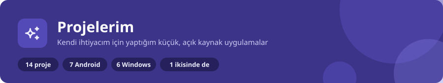

Her projenin sayfasında ne işe yaradığı, nasıl kurulacağı ve indirme bağlantısı var. Bir karta tıklayınca o projenin sayfası açılır.

### 📱 Android

<a href="https://github.com/avsessisozx/lanbeam"><picture><source media="(prefers-color-scheme: dark)" srcset="kartlar/lanbeam-koyu.svg">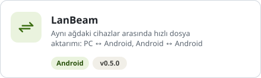</picture></a>
<a href="https://github.com/avsessisozx/Openplayer"><picture><source media="(prefers-color-scheme: dark)" srcset="kartlar/Openplayer-koyu.svg">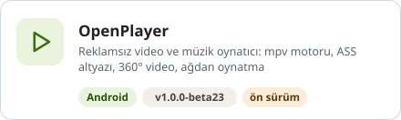</picture></a>
<a href="https://github.com/avsessisozx/Telemet"><picture><source media="(prefers-color-scheme: dark)" srcset="kartlar/Telemet-koyu.svg">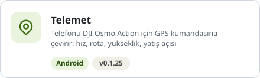</picture></a>
<a href="https://github.com/avsessisozx/eski-kamera"><picture><source media="(prefers-color-scheme: dark)" srcset="kartlar/eski-kamera-koyu.svg">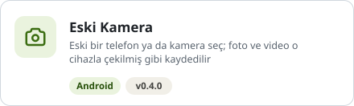</picture></a>
<a href="https://github.com/avsessisozx/sayi-atolyesi"><picture><source media="(prefers-color-scheme: dark)" srcset="kartlar/sayi-atolyesi-koyu.svg">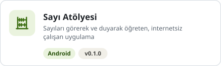</picture></a>
<a href="https://github.com/avsessisozx/xnagram"><picture><source media="(prefers-color-scheme: dark)" srcset="kartlar/xnagram-koyu.svg">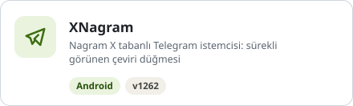</picture></a>
<a href="https://github.com/avsessisozx/Droid-WinOs"><picture><source media="(prefers-color-scheme: dark)" srcset="kartlar/Droid-WinOs-koyu.svg">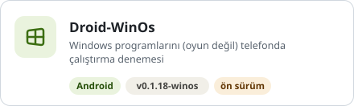</picture></a>

### 💻 Windows

<a href="https://github.com/avsessisozx/EkranIsikKontrol"><picture><source media="(prefers-color-scheme: dark)" srcset="kartlar/EkranIsikKontrol-koyu.svg">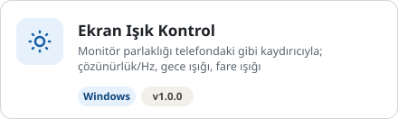</picture></a>
<a href="https://github.com/avsessisozx/K55Kontrol"><picture><source media="(prefers-color-scheme: dark)" srcset="kartlar/K55Kontrol-koyu.svg">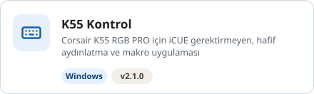</picture></a>
<a href="https://github.com/avsessisozx/douyin-indirici"><picture><source media="(prefers-color-scheme: dark)" srcset="kartlar/douyin-indirici-koyu.svg">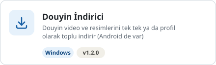</picture></a>
<a href="https://github.com/avsessisozx/instagram-indirici"><picture><source media="(prefers-color-scheme: dark)" srcset="kartlar/instagram-indirici-koyu.svg">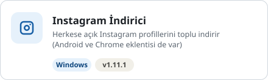</picture></a>
<a href="https://github.com/avsessisozx/Mark-Down-42"><picture><source media="(prefers-color-scheme: dark)" srcset="kartlar/Mark-Down-42-koyu.svg">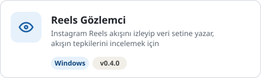</picture></a>
<a href="https://github.com/avsessisozx/kimlik-merkezi"><picture><source media="(prefers-color-scheme: dark)" srcset="kartlar/kimlik-merkezi-koyu.svg">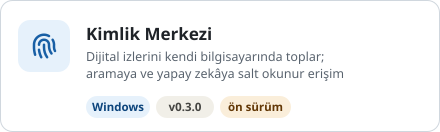</picture></a>

### 🔁 Hem Android hem Windows

<a href="https://github.com/avsessisozx/tablet-ekran"><picture><source media="(prefers-color-scheme: dark)" srcset="kartlar/tablet-ekran-koyu.svg">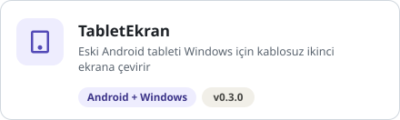</picture></a>

### 🧩 Diğer

- [APK Çalıştırıcı](https://github.com/avsessisozx/apk-calistirici): APK'ya çift tıkla, Android uygulaması Windows'ta açılsın. Geliştirme aşamasında.
- [Ekransız Android → PC](https://github.com/avsessisozx/ekransiz-android-scrcpy): Ekranı bozuk telefonu adb ve scrcpy ile bilgisayardan kontrol etme rehberi (İngilizce).
- [Kimlik Merkezi belgeleri](https://github.com/avsessisozx/kimlik-merkezi-belgeler): Kimlik Merkezi'nin geliştirme notları.
- Başkalarının projelerinden fork'lar: [apk-reverse](https://github.com/avsessisozx/apk-reverse) (APK tersine mühendislik aracı), [sabantv](https://github.com/avsessisozx/sabantv) (Cloudstream eklenti şablonu).

---

Kartlardaki sürüm numaraları her gün kendiliğinden güncellenir. Uygulamaları yalnızca bu hesabın sürüm sayfalarından indir.
